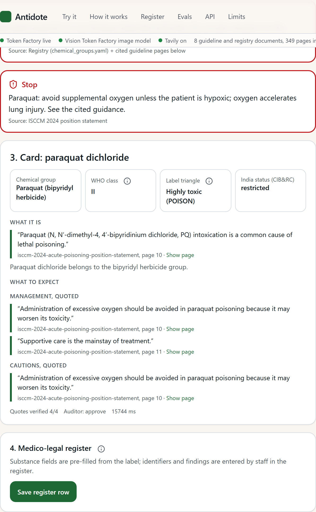

# Antidote

[](https://github.com/usv240/antidote/actions/workflows/ci.yml) [](LICENSE)

**Photograph a pesticide bottle and get the chemical, its WHO hazard class and the national guideline's own words on treatment, or a stop when no antidote exists, in under 30 seconds.**

Built on **Nebius Token Factory** with **NVIDIA Nemotron 3 Nano, 3 Super, 3 Ultra, 3.5 Lightning and 3.5 Super VL**. Best Apps and Agents track. Apache-2.0.

> **Four days to name the poison.** In July 2013, 23 children in Gandaman, Bihar, died after a school lunch was cooked in oil kept in a pesticide container. Police named the chemical, monocrotophos, four days later ([Al Jazeera](https://www.aljazeera.com/news/2013/7/21/pesticide-found-in-deadly-india-school-meal)). On a pesticide bottle, the name is printed on the label. Antidote reads it, for about 4 US cents of model calls per card.

Decision support for trained clinicians. Airway, breathing and circulation come first. Every clinical sentence on a card is quoted from a national guideline, with its page. National Poisons Information Centre, AIIMS: 1800-116-117.



## Try it in two minutes (no sign-up, no key)

| What to try | Link | What you will see |
|---|---|---|
| A real label, live | [Gramoxone (paraquat)](https://antidote-bay.vercel.app/try?sample=paraquat): click **ingested**, then **Build the card** | Two stop cards first (no antidote; no extra oxygen unless hypoxic), then a card made only of guideline quotes with their pages, an Ultra audit, and every model call with its cost |
| Two bottles, two treatments | [Landing page](https://antidote-bay.vercel.app): switch between Gramoxone and Dursban | The toxicity triangle, WHO class, stop cards and guideline line change with the bottle |
| The district view | [Register](https://antidote-bay.vercel.app/register) | A spraying-cluster alert and a district brief, from demo register rows marked as synthetic |
| The results | [Evals page](https://antidote-bay.vercel.app/evals) | 0 unsafe cards on 123 test cases; 107 unsourced doses from a general model against 0 from Antidote |
| Your own hospital | [Data page](https://antidote-bay.vercel.app/data) | Add your own protocol and stock list; cards cite your protocol |
| Your own AI agent | Add `https://antidote-api.vercel.app/mcp` as a remote MCP server in Claude, Cursor or VS Code | Four tools, no install: `list_chemicals`, `bedside_card`, `read_guideline_page`, `surveillance_alerts` |

Web: https://antidote-bay.vercel.app. API: https://antidote-api.vercel.app (OpenAPI docs at [`/docs`](https://antidote-api.vercel.app/docs)). Demo video: https://youtu.be/S8XQYCcvGmM

## Why it matters

In **94 percent** of recorded acute pesticide poisonings in India, the chemical went unidentified ([PAN India, 2026](https://pan-india.org/wp-content/uploads/2026/01/Acute-Unintentional-Pesticide-poisonings-in-India_.pdf)). Yet every Indian pesticide label must carry the active ingredient, a colour-coded toxicity triangle and an antidote statement. The chemical decides the treatment:

- In an Indian paraquat series, patients who could not name the poison were first treated for organophosphate poisoning, with atropine and oxygen, and oxygen worsens paraquat injury. The diagnosis was made from the bottle, or from **photos of it shared on WhatsApp** by relatives ([Dambal et al., 2021](https://nmji.in/reasons-for-under-reporting-of-paraquat-poisoning-in-india/)).
- In a Bangladesh hospital series, **63 of 198 patients (31.8 percent)** were misdiagnosed from symptoms alone ([Verma, Eddleston et al., 2024](https://pmc.ncbi.nlm.nih.gov/articles/PMC11149373/)).
- Case fatality ranges from **around 70 percent for paraquat** to close to 0 for many newer pesticides; WHO tells families to "take along the bottle" ([WHO, 2008](https://iris.who.int/handle/10665/44020)).
- Where poison-centre guidance reaches the bedside, **patients leave hospital 3.43 days sooner** on average ([Galvão et al., 2011](https://pmc.ncbi.nlm.nih.gov/articles/PMC10865900/)).
- In Yavatmal in 2017, about 800 cotton farm workers were admitted to hospital after spraying and more than 20 died before an investigation was ordered ([Public Eye](https://toxicexports.publiceye.ch/)). Every one of them was in a hospital register.

The full reference list is on the live site at [/references](https://antidote-bay.vercel.app/references).

## What it does

1. **Photograph the label.** Two different vision models read it. The chemical is used only when both reads agree and it appears in the text read.
2. **Name the chemical.** Antidote matches it to India's pesticide registry, with its WHO hazard class and Indian regulatory status. Tavily checks unknown brands.
3. **Stop first when it matters.** If no antidote exists (paraquat, for example), a stop card comes first. Deadly mistakes, such as atropine for paraquat, are blocked by fixed rules, not by the AI.
4. **Build the bedside card.** Every clinical sentence is quoted word for word from the NHSRC poison-management module or the ISCCM 2024 position statement, with its page. The model never writes a dose.
5. **Get a second opinion.** Nemotron 3 Ultra reads both guidelines in full and audits the card.
6. **Refuse to guess.** A smudged or torn label gets a guarded card asking the doctor to confirm from the bottle.
7. **Fill the paperwork.** One click saves the medico-legal register row, pre-filled from the label.
8. **Warn the district.** Fixed rules flag a spraying cluster (3 cases of one chemical group in 7 days), banned chemicals still reaching patients, and restricted ones. Nemotron 3.5 Lightning writes the district officer's brief.

## Architecture

```mermaid
flowchart LR
    A["Label photo"] --> B["Two vision reads<br/>Nemotron 3.5 Super VL + second model"]
    B -->|both agree| C["Registry match<br/>chemical, WHO class, India status"]
    C --> D{"Antidote exists?<br/>fixed rules"}
    D -->|no| S["Stop card first"]
    D --> E["Find guideline sentences<br/>NHSRC + ISCCM 2024"]
    S --> E
    E --> F["Nemotron 3 Super<br/>card made only of quotes"]
    F --> G["Quote checker<br/>word for word on its page"]
    G --> H["Nemotron 3 Ultra<br/>audits against both guidelines"]
    H --> I["Bedside card"]
    I --> J["Register row"]
    J --> K["District alerts<br/>+ Nemotron 3.5 Lightning brief"]
```



**The design rule: AI reads and drafts; rules decide.** The registry decides the chemical and whether an antidote exists, fixed rules raise the stop cards and block lethal errors, and the quote checker replaces any quote not found on its page with the page itself.

| Stage | Model or tool | Where it runs |
|---|---|---|
| Label reading | `nvidia/Nemotron-3.5-Super-VL`, cross-checked by `openbmb/MiniCPM-V-4_5` | Nebius Token Factory |
| Label normalisation | `nvidia/NVIDIA-Nemotron-3-Nano-30B-A3B` | Nebius Token Factory |
| Card from quotes only | `nvidia/nemotron-3-super-120b-a12b` | Nebius Token Factory |
| Audit against both guidelines in full | `nvidia/Nemotron-3-Ultra-550b-a55b` (1M-token context) | Nebius Token Factory |
| District brief (about 194,000 tokens, about one cent) | `nvidia/Nemotron-3_5-Lightning` | Nebius Token Factory |
| Offline label reading | `NVIDIA-Nemotron-Nano-12B-v2-VL` via llama.cpp | Laptop GPU |
| Brand check, ban watch, document fetching | Tavily search and extract | Tavily API |

Every call is written to a ledger (model, tokens, US dollars, seconds) and shown in the app's Trace panel.

**Data.** The registry covers 35 active ingredients in 12 chemical groups with Indian status. The WHO 2019 hazard classification is parsed into 649 chemicals, each with its source line. The guideline corpus is 349 pages. The WHO and Indian CIB&RC documents block automated downloads, so Tavily extract fetched them.

**Nebius AI Cloud.** A Serverless Endpoint served NVIDIA Nemotron Nano 12B v2 VL with vLLM on one L40S for a single-reader run of the label benchmark, and a Serverless Job cloned both of our repositories, ran every test and called the live APIs, PASS (records in the Sieve repository: [endpoint](https://github.com/usv240/sieve/blob/main/infra/endpoint-vl/RUN.md), [job](https://github.com/usv240/sieve/blob/main/infra/job-verify/RUN.md)).

**Agents.** Antidote is a hosted MCP server (above) and a local MCP server with 7 tools (`apps/mcp/antidote_mcp.py`), registered with Hermes Agent. `scripts/outbreak_watch.py` (daily) and `scripts/ban_watch.py` (weekly, Tavily search for new ban notices) run as Hermes cron jobs. The district brief also ran inside an NVIDIA OpenShell sandbox that can reach only Token Factory ([`infra/openshell/DEMONSTRATED.md`](infra/openshell/DEMONSTRATED.md)), and Hermes ran in an NVIDIA NemoClaw sandbox ([`infra/nemoclaw/DEMONSTRATED.md`](infra/nemoclaw/DEMONSTRATED.md)).

## Results

Ground truth comes from published papers and real label photos, not from Antidote's own registry. Every number, its raw output file and the command that reruns it are in [EVIDENCE.md](EVIDENCE.md).

| Test | Result |
|---|---|
| 55 open-access poisoning case reports, two pre-registered sets ([`eval/PREREG-case-reports.md`](eval/PREREG-case-reports.md), [`v2`](eval/PREREG-case-reports-v2.md)) | **0 unsafe cards**; 44 specific and correct; **10 of 12** cases where the treating team first mistook the poison set right; every other case held for confirmation |
| Agreement with the treating doctors' management | Two independent judges: 83.6 and 98.1 percent of cards consistent |
| 68 photos of real Indian pesticide labels | **0 unsafe cards**; 49 read correctly (83.3 percent when the chemical is legible); the rest held for the doctor to confirm from the bottle |
| Against a general model, same 55 cases ([`eval/PREREG-baseline-general-model.md`](eval/PREREG-baseline-general-model.md)) | Nemotron 3 Super asked directly wrote **107 drug doses with no source** in 47 of 55 answers. Antidote's cards: **0** |
| Safety controls | Lethal-error sentences blocked by rules 10 of 10; no-antidote labels raise a stop card 20 of 20; non-pesticides kept away from antidotes 10 of 10; organophosphates never falsely stopped 10 of 10 |
| Citations and classes | Quote integrity 100 percent; WHO class agreement 96.9 percent |

## Run it locally

You need Python 3.12+, [uv](https://docs.astral.sh/uv/) and Node 20+.

```bash
git clone https://github.com/usv240/antidote && cd antidote
cp .env.example .env        # add NEBIUS_API_KEY and TAVILY_API_KEY
make setup                  # install Python packages
make test                   # 57 tests, no key needed
make fetch-corpus           # download the public guideline PDFs
make ingest                 # build the search index
make dev                    # API on http://localhost:8000, docs at /docs
cd apps/web && npm install && npm run dev   # web on http://localhost:3000
```

Other commands:

- `make eval` reruns the evaluation and writes `eval/results/latest.json`.
- `make smoke` makes one real Token Factory call per model tier and prints tokens and cost.

## Repository

| Path | What it holds |
|---|---|
| `apps/api` | FastAPI service, hosted MCP endpoint |
| `apps/web` | Next.js web app |
| `apps/mcp` | Local MCP server |
| `packages/core` | The card pipeline, registry, surveillance and the WHO table |
| `packages/rules` | Clinical safety rules (`antidote.yaml`) and the rules engine |
| `packages/retrieval` | Guideline ingestion and search |
| `packages/llm` | Token Factory client, model router and cost ledger |
| `packages/vision` | Two-reader label reading |
| `packages/eval` | Benchmarks; results in `eval/results` |
| `infra` | OpenShell and NemoClaw sandboxes |
| `scripts` | Hermes watch jobs and data collection |
| `tests` | Test suite, run in CI on every push |

More: [EVIDENCE.md](EVIDENCE.md) (every number and how to rerun it), [FEEDBACK.md](FEEDBACK.md) (our notes on Nebius and NVIDIA tools), [DEPLOY.md](DEPLOY.md) (how the live site is deployed).

## Prior work

webPOISONCONTROL triages consumers in the United States from barcodes, and SprayWise reads labels for farmers' harvest intervals. Antidote is built for the doctor at the bedside: it matches the label to the Indian registry and WHO class, builds guidance only from quoted guideline sentences, stops on lethal errors, and fills the medico-legal register.

## Licence and data

Apache-2.0. Government of India documents are reproduced with acknowledgement; WHO text is quoted with attribution; the ISCCM statement is open access. Patient identifiers never enter the system; the register stores substance fields only, and the demo register rows are synthetic and marked.
